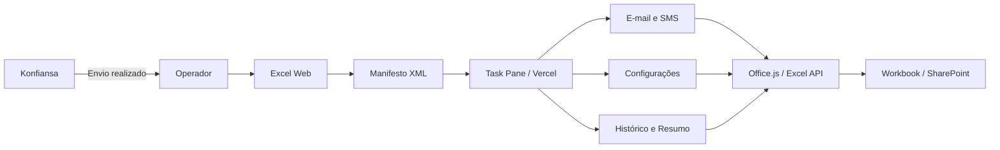

<div align="center">


# Registra

**Suplemento corporativo para Microsoft Excel Web**

Anteriormente denominado Registros de Envios; o workbook mantém seu nome original.

*Menos retrabalho. Mais controle.*


[](https://github.com/Matheus-Excelencia/Addin_Registros_Envios/actions/workflows/alpha20.yml)


[Landing page](https://addin-registros-envios.vercel.app/) · [Demonstração](https://addin-registros-envios.vercel.app/demo/index.html) · [Instalação](#instalação) · [Funcionalidades](#funcionalidades) · [Arquitetura](#arquitetura) · [Documentação](#documentação)

</div>

> Alpha 2.0 em desenvolvimento; Alpha 1.06 permanece a versão publicada. Os links públicos apontam para a produção.

## Visão geral

O Registra padroniza o registro operacional de campanhas de E-mail e SMS/URA realizadas no Konfiansa. **O suplemento não dispara mensagens.** Ele registra os envios já realizados no workbook corporativo `Registros de Envios.xlsx`, armazenado no SharePoint.

## Funcionalidades

| Módulo | Responsabilidade |
|---|---|
| Novo registro | Escolha entre E-mail e SMS |
| E-mail | Registro, validação de endereço, assunto e mensagem |
| SMS | Registro, contador e limite configurável |
| Histórico | Filtros, ordenação, duplicação, perguntas personalizadas e navegação até a linha |
| Resumo | Consolidação por período, cards, lista e gráficos |
| Configurações | Listas, mensagens, perguntas dinâmicas e formatos Excel |
| Identidade | Microsoft SSO, com contingência manual nos formulários |

### Alpha 2.0 — em desenvolvimento

- Identidade visual compartilhada, temas persistentes e abertura de sete segundos com botão Continuar.
- Resumo em cards, lista e gráficos; regras de visibilidade de perguntas no Histórico e Resumo.
- Duplicação pelo fluxo existente do Histórico, incluindo respostas personalizadas.
- Demonstração sem SSO, com reinício dos dados fictícios e da abertura; autenticação real preservada.
- Homologação pendente; não instalar como versão de produção.

### Novidades da Alpha 1.06

- Campo **Valor** opcional por padrão, numérico e contábil em reais.
- Perguntas configuráveis por formulário, tipo, obrigatoriedade e formato.
- Edição, desativação e reativação de perguntas; coluna, tipo e destino protegidos na edição.
- Avisos de duplicidade de coluna e contador de SMS na configuração.
- Saudação de boas-vindas uma vez por sessão. Digitação e esvanecimento publicados, mas não homologados; ajustes adiados.

## Instalação

**Ambiente oficial:** Excel para a Web, com conta Microsoft 365 e permissão de edição no workbook.

1. [Baixe o manifesto XML](https://addin-registros-envios.vercel.app/manifest.xml) (salve como `manifest.xml`, não como TXT).
2. Abra o workbook corporativo no Excel Web.
3. Acesse **Início → Suplementos → Avançado** ou **Inserir → Suplementos → Mais Suplementos**, conforme a interface disponível.
4. Escolha **Carregar meu suplemento**, selecione o XML e confirme o carregamento.
5. Na guia Início, procure o grupo **Excelência** e o botão **Novo registro**.
6. Confirme a abertura do painel e a identificação do usuário nos formulários.

> Os nomes dos menus podem variar. Se o carregamento personalizado estiver indisponível, consulte o administrador Microsoft 365. Não contorne políticas corporativas. Excel Desktop não é o ambiente oficial.

## Arquitetura



HTML, CSS e JavaScript compõem a interface; Office.js integra o workbook. O código é versionado no GitHub e hospedado na Vercel. Não há banco de dados independente nessa arquitetura.

## Modelo de dados

| Coluna | Email | SMS |
|---|---|---|
| A | Data | Data |
| B | Realizado por | Realizado por |
| C | Empresa | Empresa |
| D | Qtde | Qtde |
| E | Email Resposta | Supervisor |
| F | Supervisor | Obs |
| G | Obs | Historico Externo |
| H | Historico Externo | Mensagem |
| I | Mensagem | ID REGISTRO |
| J | Assunto | Valor |
| K | ID REGISTRO | — |
| L | Valor | — |

A aba `Config` contém empresas, e-mails de resposta, supervisores, realizadores, nomes e textos de mensagens de E-mail/SMS e limite SMS (A–I). Metadados adicionais incluem PERGUNTA PERSONALIZADA, FORMULARIO, TIPO RESPOSTA, OBRIGATORIA, FORMATO EXCEL, COLUNA EXCEL e PERGUNTA ATIVA, EXIBIR HISTORICO e EXIBIR RESUMO. Perguntas adicionais usam cabeçalhos próprios. Preserve a estrutura oficial; não presuma migração automática de qualquer planilha antiga.

## Regras e segurança

- Quantidade inteira positiva; campos obrigatórios preenchidos; e-mail com formato válido.
- SMS: limite padrão de 160 caracteres, configurável; bloqueio sem truncamento. O contador não estima segmentos da operadora.
- Data automática, ID de registro e confirmação de gravação; duplicação gera novo registro.
- A proteção de concorrência não equivale a transações de banco de dados.
- SSO via Office.auth.getAccessToken; fallback manual nos formulários. Não armazene tokens ou credenciais.
- Acesso ao workbook sujeito às permissões do Microsoft 365 e SharePoint.

## Qualidade e histórico

| Versão / marco | Evidência |
|---|---|
| Alpha 1.01–1.05 | Consolidação dos módulos e operação Excel Web (outubro/2026) |
| [PR #11](../../pull/11) | 22 testes; homologação 33/33 |
| [PR #12](../../pull/12) | 26 testes; homologação 33/33 |
| [PR #13](../../pull/13) | 31 testes; homologação 28/30 |
| [PR #14](../../pull/14) | [33 testes aprovados](../../actions/runs/45456326476); 20 itens manuais não validados |

As suítes são cumulativas. [82 testes aprovados no marco de segurança Alpha 2.0](../../actions/runs/45918207334); a homologação real do Excel Web continua pendente. A validação automatizada não substitui o teste no host Office.

## Organização do repositório e desenvolvimento

A raiz contém apenas configuração, documentação e ferramentas de desenvolvimento. A Vercel publica exclusivamente `public/`; os endereços existentes do Excel não mudam.

```text
.
├── .github/workflows/    # Validação automatizada
├── docs/                 # Segurança, homologação e manuais
├── public/               # Arquivos web publicados
│   ├── assets/           # Ícones e identidade visual
│   ├── demo/             # Simulação com dados fictícios
│   ├── manifest.xml      # Contrato Office
│   ├── index.html        # Landing page
│   └── ...               # Páginas e recursos do suplemento
├── scripts/              # Sincronização da demonstração
├── tests/                # Testes automatizados
├── CONTRIBUTING.md
├── README.md
└── vercel.json
```

| Módulo (em public/) | Finalidade |
|---|---|
| taskpane.* / novo.* | Menu e abertura |
| email.* / sms.* / perguntas.js | Formulários e gravação |
| config.* | Configurações |
| historico.* / resumo.* | Consulta e indicadores |
| registro-security.js | Proteção de gravações e duplicação |
| brand.* / question-visibility.js | Tema e regras de exibição |
| commands.* / manifest.xml | Integração Office |

Com Node.js 22, execute na raiz:

```bash
node scripts/sync-demo.cjs --check
node --test tests/*.test.cjs
```

Consulte [CONTRIBUTING.md](CONTRIBUTING.md) para o fluxo de desenvolvimento e publicação. O manifesto para usuários é sempre o da produção, não o arquivo bruto da branch.

## Documentação

- [Manual Alpha 2.0 (rascunho)](docs/MAN-REG-001-ALPHA-20.md)
- [Revisão de segurança](docs/ALPHA-20-SEGURANCA.md)
- [Homologação](docs/ALPHA-20-HOMOLOGACAO.md)
- [Política de atualização](docs/POLITICA-ATUALIZACAO.md)

- [Pasta oficial de documentação — SharePoint](https://excelenciacobrancaempres629.sharepoint.com/:f:/s/backofficearquivos/IgB1hL4JmiUnRJ6PWKmwB5aQAVWwebeL5AhbYGjeiiRju2M?e=48kyBS) (acesso corporativo).
- DOC-REG-007 — Alpha 1.06: edição preparada para aprovação documental.
- [Aplicação hospedada](https://addin-registros-envios.vercel.app/).
- [Histórico de commits](../../commits/main).

---

<div align="center">

**Grupo Excelência · Registra**  
Responsabilidade técnica: Matheus Passos  
Uso corporativo · Alpha 2.0 em desenvolvimento

</div>
