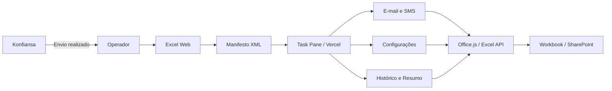

**Menos retrabalho. Mais controle.**

[Landing page](https://addin-registros-envios.vercel.app/) · [Demonstração](https://addin-registros-envios.vercel.app/demo/index.html)

> Alpha 2.0 em desenvolvimento nesta branch; Alpha 1.06 permanece a versão publicada.

# Registros de Envios

**Suplemento corporativo para Microsoft Excel Web**

[Instalação](#instalação) · [Funcionalidades](#funcionalidades) · [Arquitetura](#arquitetura) · [Documentação](#documentação)

## Visão geral

O Registros de Envios padroniza o registro operacional de campanhas de E-mail e SMS/URA realizadas no Konfiansa. **O suplemento não dispara mensagens.** Ele registra os envios já realizados no workbook corporativo `Registros de Envios.xlsx`, armazenado no SharePoint.

## Funcionalidades

| Módulo | Responsabilidade |
|---|---|
| Novo Registro | Escolha entre E-mail e SMS |
| E-mail | Registro, validação de endereço, assunto e mensagem |
| SMS | Registro, contador e limite configurável |
| Histórico | Filtros, ordenação, duplicação e navegação até a linha |
| Resumo | Consolidação por período |
| Configurações | Listas, mensagens, perguntas dinâmicas e formatos Excel |
| Identidade | Microsoft SSO, com contingência manual nos formulários |

### Novidades da Alpha 1.06

- Campo **Valor** opcional por padrão, numérico e contábil em reais.
- Perguntas configuráveis por formulário, tipo, obrigatoriedade e formato.
- Edição, desativação e reativação de perguntas; coluna, tipo e destino protegidos na edição.
- Avisos de duplicidade de coluna e contador de SMS na configuração.
- Saudação de boas-vindas uma vez por sessão. Digitação e esvanecimento publicados, mas não homologados; ajustes adiados.

## Instalação

**Ambiente oficial:** Excel para a Web, com conta Microsoft 365 e permissão de edição no workbook.

1. [Baixe o manifesto XML](https://raw.githubusercontent.com/Matheus-Excelencia/Addin_Registros_Envios/main/manifest.xml) (salve como `manifest.xml`, não como TXT).
2. Abra o workbook corporativo no Excel Web.
3. Acesse **Início → Suplementos → Avançado** ou **Inserir → Suplementos → Mais Suplementos**, conforme a interface disponível.
4. Escolha **Carregar meu suplemento**, selecione o XML e confirme o carregamento.
5. Na guia Início, procure o grupo **Registros** e o botão **Novo Registro**.
6. Confirme a abertura do painel e a identificação do usuário nos formulários.

> Os nomes dos menus podem variar. Se o carregamento personalizado estiver indisponível, consulte o administrador Microsoft 365. Não contorne políticas corporativas. Excel Desktop não é o ambiente oficial.

## Arquitetura

HTML, CSS e JavaScript compõem a interface; Office.js integra o workbook. O código é versionado no GitHub e hospedado na Vercel. Não há banco de dados independente nessa arquitetura.

## Modelo de dados

| Coluna | Email | SMS |
|---|---|---|
| A | Data | Data |
| B | Realizado por | Realizado por |
| C | Empresa | Empresa |
| D | Qtde | Qtde |
| E | Email Resposta | Supervisor |
| F | Supervisor | Obs |
| G | Obs | Historico Externo |
| H | Historico Externo | Mensagem |
| I | Mensagem | ID REGISTRO |
| J | Assunto | Valor |
| K | ID REGISTRO | — |
| L | Valor | — |

A aba `Config` contém empresas, e-mails de resposta, supervisores, realizadores, nomes e textos de mensagens de E-mail/SMS e limite SMS (A–I). Metadados adicionais incluem PERGUNTA PERSONALIZADA, FORMULARIO, TIPO RESPOSTA, OBRIGATORIA, FORMATO EXCEL, COLUNA EXCEL e PERGUNTA ATIVA. Perguntas adicionais usam cabeçalhos próprios. Preserve a estrutura oficial; não presuma migração automática de qualquer planilha antiga.

## Regras e segurança

- Quantidade inteira positiva; campos obrigatórios preenchidos; e-mail com formato válido.
- SMS: limite padrão de 160 caracteres, configurável; bloqueio sem truncamento. O contador não estima segmentos da operadora.
- Data automática, ID de registro e confirmação de gravação; duplicação gera novo registro.
- A proteção de concorrência não equivale a transações de banco de dados.
- SSO via Office.auth.getAccessToken; fallback manual nos formulários. Não armazene tokens ou credenciais.
- Acesso ao workbook sujeito às permissões do Microsoft 365 e SharePoint.

## Qualidade e histórico

| Versão / marco | Evidência |
|---|---|
| Alpha 1.01–1.05 | Consolidação dos módulos e operação Excel Web (outubro/2026) |
| [PR #11](../../pull/11) | 22 testes; homologação 33/33 |
| [PR #12](../../pull/12) | 26 testes; homologação 33/33 |
| [PR #13](../../pull/13) | 31 testes; homologação 28/30 |
| [PR #14](../../pull/14) | [33 testes aprovados](../../actions/runs/45456326476); 20 itens manuais não validados |

As suítes são cumulativas. A última homologação visual relatou que as melhorias não funcionaram como esperado; não há diagnóstico conclusivo. O fallback de inicialização Office.js ainda carece de teste específico e a revisão de logs de produção está pendente. A validação funcional anterior não substitui uma nova homologação.

## Desenvolvimento e manutenção

| Arquivo / grupo | Finalidade |
|---|---|
| manifest.xml | Integração, permissões, comandos e identidade |
| taskpane.* | Menu e boas-vindas |
| email.* / sms.* | Formulários e gravação |
| perguntas.js | Regras compartilhadas de perguntas |
| config.* | Configurações |
| commands.* / assets/ | Comandos e ícones |
| tests/alpha106.test.cjs | Suíte automatizada |

Execute `node --test tests/alpha106.test.cjs` na raiz do projeto com Node.js. Trabalhe em branch separada para alterações funcionais, valide o Excel Web, preserve manifesto e SSO, crie backup antes do merge autorizado e confira o deploy. Atualize parâmetros de cache quando necessário.

## Documentação

- [Pasta oficial de documentação — SharePoint](https://excelenciacobrancaempres629.sharepoint.com/:f:/s/backofficearquivos/IgB1hL4JmiUnRJ6PWKmwB5aQAVWwebeL5AhbYGjeiiRju2M?e=48kyBS) (acesso corporativo).
- DOC-REG-007 — Alpha 1.06: edição preparada para aprovação documental.
- [Aplicação hospedada](https://addin-registros-envios.vercel.app/).
- [Histórico de commits](../../commits/main).

---

**Grupo Excelência · Registros de Envios**  
Responsabilidade técnica: Matheus Passos  
Uso corporativo · Alpha 1.06

